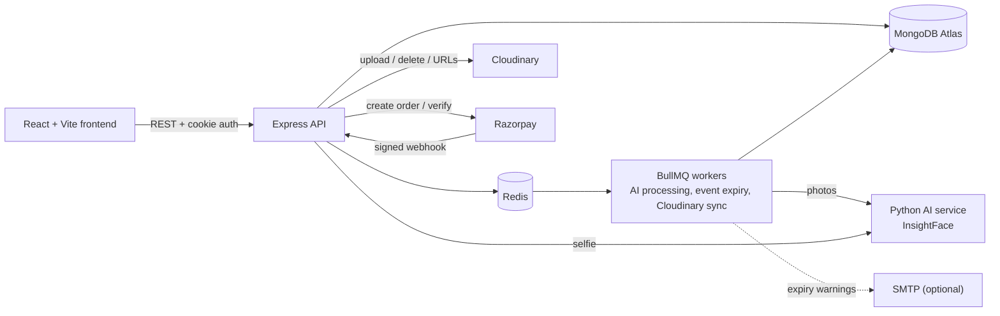
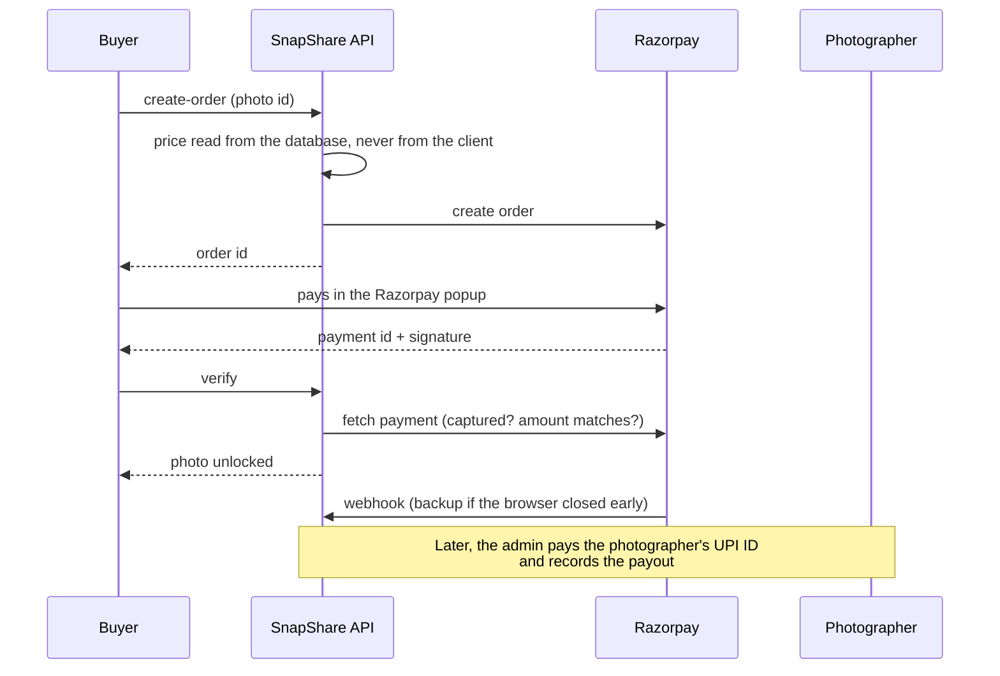

# SnapShare

**Event photo sharing with face matching and pay-per-photo.** An organizer creates an event, photographers upload the official shots, guests add their own, and everyone finds *their* photos by uploading a selfie instead of scrolling through hundreds of pictures.

## Contents

- [Features](#features)
- [Architecture](#architecture)
- [How face matching works](#how-face-matching-works)
- [How payments work](#how-payments-work)
- [Quick start (Docker)](#quick-start-docker)
- [Running it day to day](#running-it-day-to-day)
- [Testing payments](#testing-payments)
- [Roles](#roles)
- [Tests and CI](#tests-and-ci)
- [Tuning face matching](#tuning-face_match_threshold)
- [Demo script](#demo-script-5-minutes)
- [Deployment](#deployment)
- [Security notes](#security-notes)
- [Limitations](#limitations)
- [Roadmap](#roadmap)
- [Project layout](#project-layout)

## Features

**For guests (participants)**
- Join an event with its ID and passcode, or by scanning a QR code
- **Find My Photos:** upload a selfie and get every photo you appear in, split into confident matches and "possible matches" to double-check. Your selfie and its face data are never stored
- Like, favourite and download photos, or download all your matches as a ZIP
- Buy paid photos (watermarked previews until purchased) and see everything you bought under **Purchases**
- **Report** a photo that shouldn't be there

**For photographers**
- Join an event by code or QR (or be added by the organizer's email) and upload to the Official album
- Set a price on individual photos
- **Sales page:** see who bought what, what you earned and what you're still owed
- Add a UPI ID in Profile to get paid

**For organizers**
- Create events with a cover image, expiry date, and participant and photographer passcodes with QR codes
- Co-organizers, participant and photographer management (emails are masked)
- Event stats, extend the event, sync with Cloudinary
- **Reports tab:** review photos participants flagged, then remove or keep them
- **Export all photos** as one ZIP (Official/ and Community/ folders)
- A banner in the app, plus an optional email, 48 hours before the event closes

**Live and big-screen**
- **Live slideshow** (`/events/:slug/slideshow`): a fullscreen, auto-advancing wall for a projector or TV. New uploads join the queue by themselves
- **"N new photos" banner** in the gallery: no refresh needed to see what others upload

**Account and admin**
- **Delete my account** (Profile → Security): removes personal data and your unsold uploads, and keeps photos other people have already bought
- **Admin payouts page** (`/admin/payouts`): see what each photographer is owed and record each payout

## Architecture



| Part | Tech |
|---|---|
| Frontend | React, Vite, Tailwind v4, React Router |
| API | Node.js, Express 5, Mongoose, Zod validation |
| Jobs | BullMQ on Redis: photo AI processing, event expiry sweep (every 15 min), Cloudinary reconciliation (every 6 h) |
| AI | Python + InsightFace (`buffalo_l`), cosine-similarity matching |
| Storage | Cloudinary (images), MongoDB Atlas (data) |
| Payments | Razorpay Checkout + signed webhook |

## How face matching works

1. When a photo is uploaded, a background job sends it to the AI service, which detects every face and returns one embedding (a vector of numbers) per face. These are stored against the photo, scoped to that event.
2. When a guest runs **Find My Photos**, their selfie goes to the AI service and is turned into an embedding. It is compared against that event's stored embeddings and then **thrown away**. Matches above `FACE_MATCH_THRESHOLD` are returned, with weaker ones shown separately as possible matches.
3. The guest's matches are saved as a list of photo IDs, so they can come back later without re-uploading a selfie.

**Privacy rules built into the code:** embeddings are `select: false` and never serialised into any API response; every query is scoped by `eventId`; the user must have joined the event first; selfies are never persisted.

## How payments work



- **Money flow:** buyers pay SnapShare's Razorpay account. Photographers add a **UPI ID**, and the admin pays them from `/admin/payouts` (a UPI link opens the payment on a phone), then records the transaction ID. Sales then shows "Paid out".
- **Why manual:** Razorpay Route (automatic split payouts) needs account approval and bank/KYC details for every photographer.
- **Safety checks:** HMAC signature verification, a second check with Razorpay that the payment is captured and the amount matches, idempotent unlocking (verify and webhook can race safely), a per-photo price snapshot taken when the order is created, and a signed webhook.
- **Platform fee:** `PLATFORM_FEE_PERCENT` (default `0`) is deducted from what photographers earn.
- **Slow confirmations:** if Razorpay hasn't captured the payment yet, the app shows "confirming" and checks again for about 30 seconds. The webhook unlocks it too.

## Quick start (Docker)

Needs Docker with Compose. Node and Python don't need to be installed.

### 1. Environment files

Create `backend/.env` (see `backend/.env.example` for every variable):

| Variable | Purpose |
|---|---|
| `MONGO_URI` | MongoDB Atlas connection string |
| `JWT_SECRET` | any long random string |
| `PASSCODE_ENCRYPTION_KEY` | 64 hex characters, lets organizers view passcodes again. Generate one: `node -e "console.log(require('crypto').randomBytes(32).toString('hex'))"` |
| `CLOUDINARY_CLOUD_NAME`, `CLOUDINARY_API_KEY`, `CLOUDINARY_API_SECRET` | from the Cloudinary dashboard |
| `RAZORPAY_KEY_ID`, `RAZORPAY_KEY_SECRET` | Razorpay **test-mode** keys |
| `RAZORPAY_WEBHOOK_SECRET` | the secret you set on the Razorpay webhook (see below) |
| `ADMIN_EMAILS` | comma-separated emails allowed to open `/admin/payouts` |
| `PLATFORM_FEE_PERCENT` | % of each sale you keep (default `0`) |
| `AI_SERVICE_SHARED_SECRET` | random string, must equal `INTERNAL_SHARED_SECRET` in `ai-service/.env` |
| `FACE_MATCH_THRESHOLD` | start at `0.5` |
| `MAX_EXPORT_PHOTOS` | optional, cap on one event export (default `400`) |
| `SMTP_HOST`, `SMTP_PORT`, `SMTP_USER`, `SMTP_PASS`, `EMAIL_FROM`, `EMAIL_TIMEZONE` | *optional*. Enable expiry-warning emails. Also run `cd backend && npm install nodemailer` |

`docker-compose.yml` already sets `REDIS_URL`, `AI_SERVICE_URL` and `FRONTEND_URL` for the containers. Don't change them to `localhost`.

Create `ai-service/.env` (see `ai-service/.env.example`):

```env
INTERNAL_SHARED_SECRET=<same value as AI_SERVICE_SHARED_SECRET above>
INSIGHTFACE_MODEL_NAME=buffalo_l
```

### 2. Start it

```bash
docker compose up --build
```

| Service | URL |
|---|---|
| Frontend | http://localhost:5173 |
| API | http://localhost:5000 (health check: `/api/health`) |
| AI service | http://localhost:8000 |

The first start downloads the face model (a few hundred MB). Later starts are fast.

## Running it day to day

The code is copied into the Docker images when they're built, so **changes only show up after a rebuild**:

| You did | Run |
|---|---|
| Just starting work | `docker compose up` |
| Pasted or changed any code | `docker compose up --build` |
| Edited only `backend/.env` | `docker compose up -d --force-recreate backend` |
| Want to see errors | `docker compose logs -f backend` |
| Stop everything | `Ctrl+C`, or `docker compose down` if started with `-d` |

Avoid `docker compose down -v`. It deletes the downloaded face model and Redis data.

## Testing payments

1. **Razorpay webhook** (Test Mode → Settings → Webhooks). Razorpay can't reach `localhost`, so run `ngrok http 5000` and use:
   - URL: `https://<your-ngrok-address>/api/payments/webhook`
   - Secret: any random string, copied into `RAZORPAY_WEBHOOK_SECRET`
   - Events: `payment.captured` and `order.paid`
   - A free ngrok address changes every restart, so update the URL each time.
2. **Set up:** the photographer adds a UPI ID in Profile and prices a photo. Buying fails until the photographer has a UPI ID.
3. **Pay as a different account** (you can't buy your own photo). In the Razorpay popup use **Netbanking → any bank → Success**. A test card such as `5267 3181 8797 5449` (any future expiry and CVV) also works. `4111 1111 1111 1111` is rejected as an international card on default accounts, and UPI only appears if Razorpay has enabled it for your account.
4. **Check:** the photo unlocks; the buyer sees it under **Purchases**; the photographer sees the buyer under **Sales** as Pending; after the admin records a payout it shows **Paid out**. The ngrok inspector (http://127.0.0.1:4040) should show `POST /api/payments/webhook 200`.

## Roles

There is no role picker at signup. A role belongs to an *event*, not an account:

- **Create Event** → you're that event's organizer
- **Join Event** → ID and passcode, or scan the participant QR (`/join/:eventId/:joinToken`)
- **Join as Photographer** → ID and photographer code, or the photographer QR (`/join-photographer/:eventId/:photographerToken`). Organizers can also add a photographer by email

The same account can organize one event, photograph a second and just attend a third. Admin (the payouts page) is the one global permission, set with `ADMIN_EMAILS`.

## Tests and CI

```bash
cd backend && npm test                              # Vitest + Supertest + mongodb-memory-server
cd frontend && npm run lint && npm run build
```

Run `npm test` on your own machine. The Docker image skips dev dependencies. `mongodb-memory-server` downloads a real MongoDB binary the first time, so it needs normal internet access.

GitHub Actions (`.github/workflows/ci.yml`) runs the backend tests, the frontend lint and build, and an AI-service syntax check on every push and pull request.

Backend coverage today: auth, event access control and joining, passcode reveal, and face-embedding privacy. Payments, reports, account deletion and exports don't have automated tests yet (see Roadmap).

## Tuning FACE_MATCH_THRESHOLD

1. Upload test photos with known people in them
2. Run Find My Photos with selfies of the same people
3. Start at `0.5`. Raise it for fewer false positives (it may miss real matches), lower it to catch more (it may add wrong ones)
4. ArcFace embeddings usually separate well between `0.4` and `0.6` cosine similarity, but it depends on your photo quality, angles and lighting

## Customizing fonts and colors

Everything lives in `frontend/src/styles/theme.css` as CSS variables under `@theme`, used through Tailwind classes such as `bg-primary`. To change the font, update `--font-sans` there and the Google Fonts `<link>` in `frontend/index.html`.

## Demo script (5 minutes)

1. **Organizer** creates an event and shows the passcode and QR in Settings
2. **Photographer** (second browser) joins by QR, uploads photos and prices one
3. **Guest** joins and runs **Find My Photos** with a selfie, and their matches appear
4. Guest buys the paid photo with Razorpay's test checkout, it unlocks, and it shows under **Purchases**
5. Photographer opens **Sales** and sees the buyer and the amount owed
6. Admin opens `/admin/payouts` and marks the photographer as paid
7. Organizer opens the **Slideshow** on a second screen, then the guest uploads a photo and it appears automatically
8. Guest **reports** a photo, and the organizer reviews it in the **Reports** tab
9. Organizer downloads **Export all photos** from Settings

## Deployment

- **Frontend** → Vercel (`vercel.json` included, SPA rewrites configured)
- **Backend, AI service and Redis** → Render (`backend/render.yaml` Blueprint)
- **Database** → MongoDB Atlas · **Images** → Cloudinary · **Payments** → Razorpay. Switch to live keys when ready and create a **separate live-mode webhook** with its own secret

Set every `sync: false` variable in the Render dashboard (Mongo URI, Cloudinary secret, Razorpay keys, webhook secret, admin emails, frontend URL, AI secret). Never commit credentials.

## Security notes

- **Passwords:** bcrypt with 12 salt rounds. Changing a password signs out all older sessions
- **Event passcodes:** bcrypt-hashed to verify joins, plus an encrypted copy so organizers can view them again
- **Auth:** JWT in an httpOnly cookie (Bearer also accepted), re-checked against the database on every request
- **Payments:** signature verified on the server, payment re-checked with Razorpay, prices never trusted from the client, webhook signature checked over the raw request body
- **Face data:** see *How face matching works*
- **Privacy:** participant and photographer emails are masked for organizers; UPI IDs are shown only to their owner and the admin
- **Rate limits:** tighter limits on auth, payments, reports, exports and Find My Photos than the global default

## Limitations

- **Payouts are manual.** The platform holds buyers' money until the admin pays photographers, so the operator is responsible for paying on time, and a refund or chargeback after a payout comes out of the operator's pocket. Automatic split payouts through Razorpay Route are the natural next step once the account is approved.
- No refund flow and no GST/TDS handling. Check local rules before handling real money.
- UPI and international cards for **buyers** depend on what Razorpay enables for the account.
- Event export is capped (`MAX_EXPORT_PHOTOS`) and streams through the API server, which is fine for a few hundred photos.
- Gallery "live" updates use light polling (every 15 s), not WebSockets.
- Deleting an account is blocked while the user owns events or has unpaid earnings.
- No forgot-password flow yet.

## Roadmap

Forgot-password and email verification · automated tests for payments, reports and exports · bulk photo pricing · organizer analytics charts · notifications when a photo sells · refunds · Razorpay Route payouts · an optional "People" view that groups photos by person (with explicit consent) · API docs and a demo seed script.

## Project layout

```text
backend/     Express API: routes, controllers, services, models, BullMQ jobs, tests
frontend/    React app: pages, components, services, hooks, theme
ai-service/  Python InsightFace service
docker-compose.yml, backend.Dockerfile, frontend.Dockerfile
.github/workflows/ci.yml
```

## Git workflow

`main` is stable and deployable · `develop` is the integration branch · `feature/*` is one branch per feature.