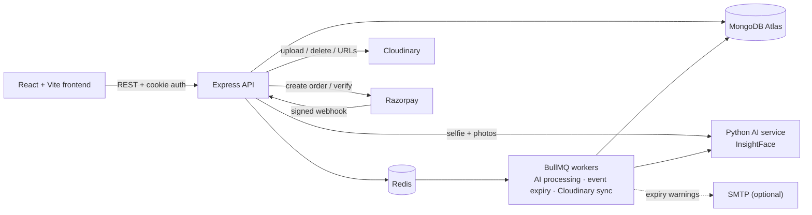
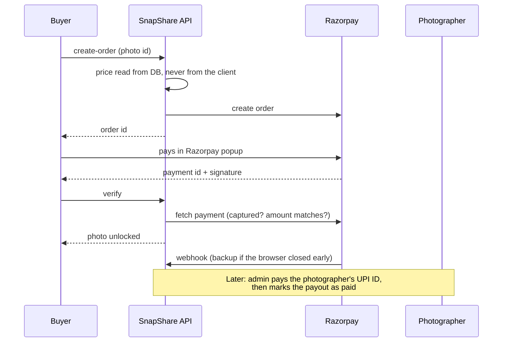

# SnapShare

[](../../actions/workflows/ci.yml)

**Event photo sharing with face-matching and pay-per-photo.** An organizer creates an event, photographers upload the official shots, guests add their own, and everyone finds *their* photos by uploading a selfie, with no scrolling through hundreds of pictures.

> Screenshots: add yours under `docs/screenshots/` and link them here (event gallery, Find My Photos, slideshow, sales page).

## Features

**For guests (participants)**
- Join an event with its ID + passcode, or by scanning a QR code
- **Find My Photos:** upload a selfie and get every photo you appear in, with a match-confidence badge. Your selfie and its face data are never stored
- Like, favourite, download, and download all your matches as a ZIP
- Buy paid photos (watermarked previews until purchased); see everything you bought under **Purchases**
- **Report** a photo that shouldn't be there

**For photographers**
- Join an event by code/QR (or be added by email) and upload to the Official album
- Price individual photos; see **who bought what** and what you're owed on the **Sales** page
- Add a UPI ID in Profile to get paid

**For organizers**
- Create events with cover image, expiry date, participant and photographer passcodes + QR codes
- Co-organizers, participant/photographer management (emails are masked)
- Event stats, extend the event, sync with Cloudinary
- **Reports tab:** review photos participants flagged, then remove or keep them
- **Export all photos** as one ZIP (Official/ and Community/ folders)
- Email warning 48 hours before the event closes (optional, needs SMTP)

**Live and big-screen**
- **Live slideshow** (`/events/:slug/slideshow`): fullscreen auto-advancing wall for a projector or TV. New uploads join the queue automatically
- **"N new photos" banner** in the gallery: no refresh needed to see what others upload

**Account and safety**
- **Delete my account** (Profile → Security): removes personal data, deletes your unsold uploads, keeps anything others have already bought
- Rate limiting on auth, payments, reports, exports and Find My Photos

## Architecture



| Part | Tech |
|---|---|
| Frontend | React, Vite, Tailwind v4, React Router |
| API | Node.js, Express 5, Mongoose, Zod validation |
| Jobs | BullMQ on Redis (photo AI processing, event expiry sweep every 15 min, Cloudinary reconciliation) |
| AI | Python + InsightFace (`buffalo_l`), cosine-similarity matching |
| Storage | Cloudinary (images), MongoDB Atlas (data) |
| Payments | Razorpay Checkout + signed webhook |

## How face matching works

1. When a photo is uploaded, a background job sends it to the AI service, which detects every face and returns one embedding (a vector of numbers) per face. These are stored against the photo, scoped to the event.
2. When a guest runs **Find My Photos**, their selfie goes to the AI service, is turned into an embedding, compared against that event's stored embeddings, and **thrown away**. Matches above `FACE_MATCH_THRESHOLD` are returned.
3. The guest's matches are saved as a list of photo IDs, so they can come back without re-uploading a selfie.

**Privacy rules** built into the code: embeddings are `select: false` and never serialised into any API response; every query is scoped by `eventId`; the user must have joined the event first; selfies are never persisted.

## How payments work



- **Money flow:** buyers pay SnapShare's Razorpay account. Photographers add a **UPI ID**, and the admin pays them out manually from `/admin/payouts` (a UPI deep link opens the payment on a phone), then records the transaction ID.
- **Why manual:** Razorpay Route (automatic split payouts) needs approval and bank/KYC details per photographer. See *Limitations*.
- **Safety checks:** HMAC signature verification, amount/order re-check with Razorpay, idempotent unlocking (verify and webhook can race safely), a per-item price snapshot taken at order time, and a signed webhook.
- **Platform fee:** `PLATFORM_FEE_PERCENT` (default 0).

## Quick start with Docker

Needs Docker with Compose. Node and Python do not need to be installed.

### 1. Environment files

Create `backend/.env` (see `backend/.env.example` for every variable):

| Variable | Purpose |
|---|---|
| `MONGO_URI` | MongoDB Atlas connection string |
| `JWT_SECRET` | any long random string |
| `PASSCODE_ENCRYPTION_KEY` | 64 hex chars; lets organizers view passcodes again. Generate: `node -e "console.log(require('crypto').randomBytes(32).toString('hex'))"` |
| `CLOUDINARY_CLOUD_NAME` / `_API_KEY` / `_API_SECRET` | Cloudinary dashboard |
| `RAZORPAY_KEY_ID` / `_KEY_SECRET` | Razorpay **test-mode** keys |
| `RAZORPAY_WEBHOOK_SECRET` | the secret you set on the webhook (below) |
| `ADMIN_EMAILS` | comma-separated emails allowed to open `/admin/payouts` |
| `PLATFORM_FEE_PERCENT` | % kept per sale (default `0`) |
| `AI_SERVICE_SHARED_SECRET` | random string, must match the AI service |
| `FACE_MATCH_THRESHOLD` | start at `0.5` (see tuning below) |
| `SMTP_HOST`, `SMTP_PORT`, `SMTP_USER`, `SMTP_PASS`, `EMAIL_FROM` | *optional*, enable expiry-warning emails (`cd backend && npm install nodemailer`) |
| `MAX_EXPORT_PHOTOS` | optional cap on one event export (default `400`) |

`docker-compose.yml` sets `REDIS_URL`, `AI_SERVICE_URL` and `FRONTEND_URL` for you. Don't change `redis` / `ai-service` to `localhost` inside the containers.

Create `ai-service/.env` containing the same `AI_SERVICE_SHARED_SECRET`.

### 2. Run it

```bash
docker compose up --build        # add -d to run in the background
```

| Service | URL |
|---|---|
| Frontend | http://localhost:5173 |
| API | http://localhost:5000 (health: `/api/health`) |
| AI service | http://localhost:8000 |

Useful commands: `docker compose logs -f backend`, `docker compose restart backend`, `docker compose down` (add `-v` to also drop the Redis and InsightFace model volumes; the model re-downloads next start).

### 3. Razorpay webhook (needed for payments to unlock reliably)

Razorpay must be able to reach your backend, so locally use a tunnel (e.g. `ngrok http 5000`).

1. Razorpay Dashboard (Test Mode) → Settings → Webhooks → **Add**
2. URL: `https://<your-tunnel-or-domain>/api/payments/webhook`
3. Secret: any random string; put the same value in `RAZORPAY_WEBHOOK_SECRET`
4. Events: `payment.captured` and `order.paid`
5. Test card: `5267 3181 8797 5449` (any future expiry and CVV), or Netbanking → Success

## Roles

There is no role picker at signup. A role belongs to an *event*, not an account:

- **Create Event** → you're that event's organizer
- **Join Event** → ID + passcode, or scan the participant QR (`/join/:eventId/:joinToken`)
- **Join as Photographer** → ID + photographer code, or the photographer QR (`/join-photographer/:eventId/:token`); organizers can also add a photographer by email

The same account can organize one event, photograph a second and just attend a third. Admin (payouts page) is the one global permission, set via `ADMIN_EMAILS`.

## Tests and CI

```bash
cd backend && npm test          # Vitest + Supertest + mongodb-memory-server
cd frontend && npm run lint && npm run build
```

`mongodb-memory-server` downloads a real MongoDB binary on first run, so it needs normal internet access. GitHub Actions (`.github/workflows/ci.yml`) runs the backend tests, frontend lint + build and an AI-service syntax check on every push and pull request.

Current backend coverage: auth, event RBAC and joining, passcode reveal, and face-embedding privacy. Payments, reports, account deletion and exports don't have automated tests yet (see Roadmap).

## Tuning FACE_MATCH_THRESHOLD

1. Upload test photos with known people in them
2. Run Find My Photos with selfies of the same people
3. Start at `0.5`. Raise it for fewer false positives (may miss real matches), lower it to catch more (may add false ones)
4. ArcFace embeddings usually separate well between `0.4` and `0.6` cosine similarity, but it depends on your photo quality, angles and lighting

## Customizing fonts and colors

Everything lives in `frontend/src/styles/theme.css` as CSS variables under `@theme`, referenced via Tailwind classes such as `bg-primary`. To change the font, update `--font-sans` there and the Google Fonts `<link>` in `frontend/index.html`.

## Demo script (5 minutes)

1. **Organizer** creates an event; show the passcode and QR in Settings
2. **Photographer** (second browser/profile) joins by QR, uploads photos, prices one
3. **Guest** joins, opens **Find My Photos** with a selfie → matches appear with confidence badges
4. Guest buys the paid photo (Razorpay test card) → it unlocks; show **Purchases**
5. Photographer opens **Sales** → sees the buyer and the amount owed
6. Admin opens `/admin/payouts` → marks the photographer as paid
7. Organizer opens the **Slideshow** on a second screen, then uploads a photo as the guest → it appears automatically
8. Guest **reports** a photo → organizer reviews it in the **Reports** tab

## Deployment

- **Frontend** → Vercel (`vercel.json` included, SPA rewrites configured)
- **Backend + AI service + Redis** → Render (`backend/render.yaml` Blueprint)
- **Database** → MongoDB Atlas · **Images** → Cloudinary · **Payments** → Razorpay (switch to live keys when ready; create a separate live-mode webhook with its own secret)

Set every `sync: false` variable in the Render dashboard (Mongo URI, Cloudinary secret, Razorpay keys, webhook secret, admin emails, frontend URL, AI secret). Never commit credentials.

## Security notes

- Passwords: bcrypt, 12 salt rounds; a password change signs out all older sessions
- Event passcodes: bcrypt-hashed for verifying joins, plus an encrypted copy so organizers can view them again
- Auth: JWT in an httpOnly cookie (Bearer also accepted), re-verified against the database on every request
- Payments: signature verified server-side, payment re-checked with Razorpay, prices never trusted from the client, webhook signature checked over the raw body
- Face data: see *How face matching works*
- Participant/photographer emails are masked for organizers; payout UPI IDs are never returned except to their owner and the admin
- Rate limits: tighter on `/auth`, `/payments`, reports, exports and `/find-my-photos` than the global default

## Limitations

- **Payouts are manual.** The platform holds buyers' money until the admin pays photographers. That means the operator is responsible for paying on time, and refunds/chargebacks after a payout come out of the operator's pocket. Automatic split payouts via Razorpay Route are the natural next step once the account is approved.
- No refund flow yet; no GST/TDS handling. Check local rules before using real money.
- Event export is capped (`MAX_EXPORT_PHOTOS`) and streams through the API server, which is fine for a few hundred photos.
- Gallery "live" updates use light polling (every 15 s), not WebSockets.
- Deleting an account is blocked while the user owns events or has unpaid earnings.

## Roadmap

Forgot-password and email verification · automated tests for payments, reports and exports · bulk photo pricing · organizer analytics charts · notifications when a photo sells · refunds · Razorpay Route payouts · optional "People" view grouping photos by person (with explicit consent).

## Project layout

```text
backend/    Express API (routes, controllers, services, models, BullMQ jobs, tests)
frontend/   React app (pages, components, services, hooks, theme)
ai-service/ Python InsightFace service
docker-compose.yml, backend.Dockerfile, frontend.Dockerfile
.github/workflows/ci.yml
```

## Git workflow

`main` is stable and deployable · `develop` is the integration branch · `feature/*` is one branch per feature.